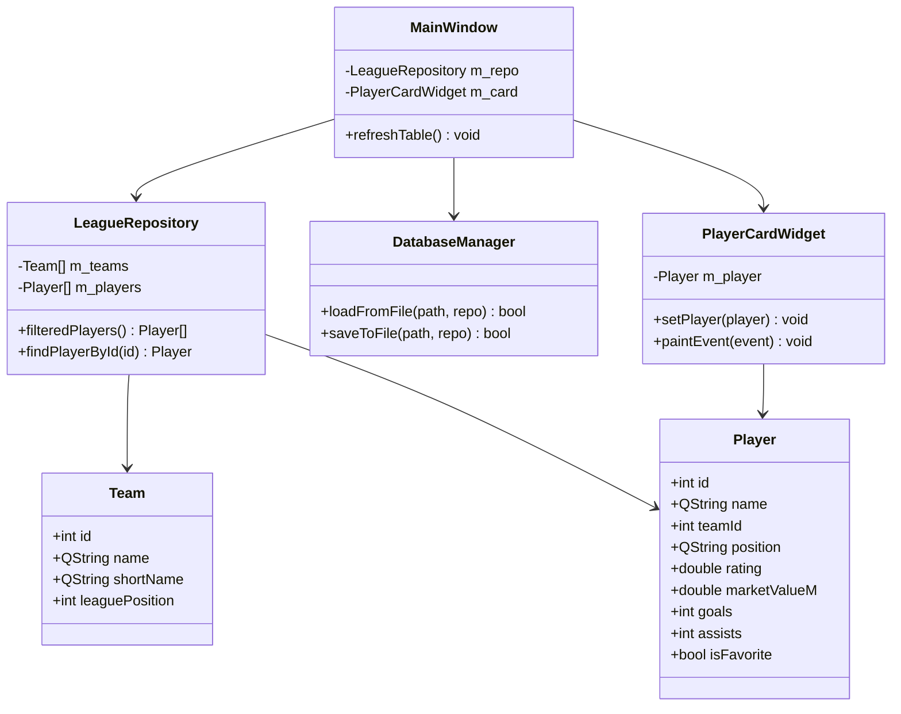

# Схема классов — SmartFootball

`+` — `public` (открытые поля/методы), `-` — `private` (закрытые поля/методы).

---

> **Примечание:** архитектура приложения пока находится в разработке и будет дополняться по мере реализации модулей (фильтры, поиск и запросы, загрузка данных и сравнение игроков), но эти базовые классы являются обязательным минимумом для работы приложения.
